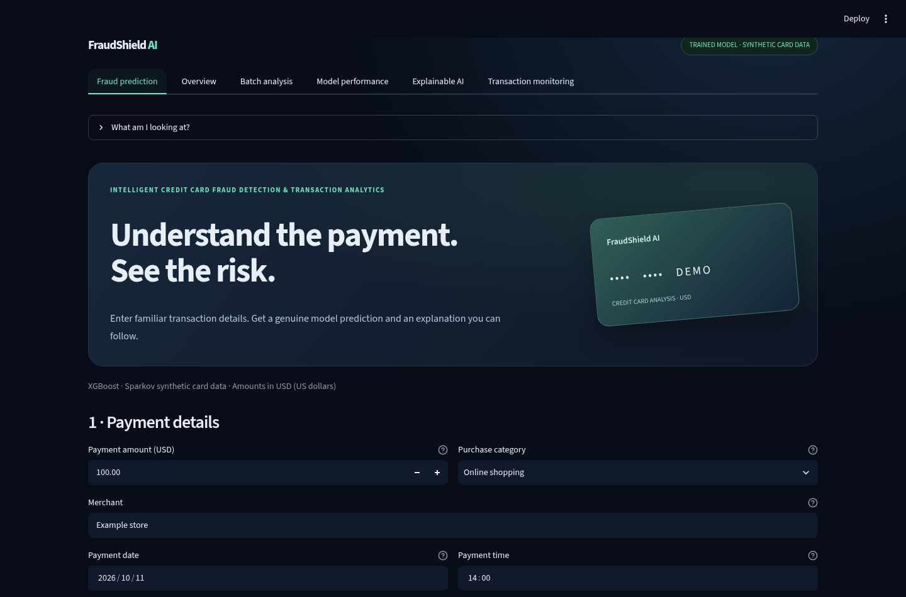

# FraudShield AI

A credit-card transaction classifier with readable inputs, historical spending features and SHAP explanations. Built by **Vishnu R Nair** as a machine-learning application project.

[Live application](https://creditvault.streamlit.app/) · [Technical reference](docs/TECHNICAL_REFERENCE.md) · [Learning guide](docs/LEARNING_GUIDE.md)



## What it does

- Score a manually entered USD purchase with earlier spending summaries, demo history or no history.
- Validate and score transaction CSVs; download every result.
- Compare Logistic Regression and XGBoost using chronological evaluation.
- Inspect actual SHAP contributions and session-level transaction monitoring.

The model uses **Sparkov synthetic transactions**. It has no bank connection. Its score is uncalibrated and is not a verified probability of fraud.

## Run locally

Use Python 3.12 and the recorded dependency versions, which match the exported model.

```bash
git clone https://github.com/me-vishnurnair/Machine-learning-project.git
cd Machine-learning-project
python -m venv .venv
source .venv/bin/activate
python -m pip install -r requirements.txt
python -m streamlit run app.py
```

On Windows PowerShell, use `.venv\Scripts\Activate.ps1` instead of `source`. The model and demo assets are bundled; running the app needs no API key or retraining.

## Implementation

| Path | Responsibility |
| --- | --- |
| `app.py` | Public Streamlit entry point |
| `shield_dashboard.py` | Six application pages and session state |
| `shield_core.py` | Inference, input validation and SHAP explanations |
| `card_core.py`, `manual_card_core.py` | Earlier-history features and manual summaries |
| `train_shield.py` | Reproducible model selection and export |
| `shield_artifacts/` | Current model, feature definitions, provenance and measured results |
| `scripts/`, `tests/` | Data preparation, evaluation and behavior checks |
| `docs/` | Current reference, learning material and historical archive |

Older model modules and artifact folders are retained for reproducibility. **The public app starts at `app.py` and uses `shield_artifacts/`.** Historical model scores do not describe the current application.

## Evaluation

The development holdout contains 107,706 later transactions, including 176 fraud labels. The selected XGBoost model, with earlier history available, detects 119 fraud cases, misses 57 and incorrectly flags 55 legitimate transactions: **68.39% precision, 67.61% recall and 68.00% F1**.

These are measured synthetic-data results, not real-bank validation. Missing-history performance is reported separately. See the [dataset, split, thresholds and full metrics](docs/TECHNICAL_REFERENCE.md#training-and-honest-evaluation) and [source audit](docs/FINAL_PROJECT_AUDIT.md).

## Test and deploy

```bash
python -m pip install -r requirements-dev.txt
python -m pytest -q
python scripts/verify_deployment.py --expected-commit <deployed-commit-sha>
```

The public app is connected to this repository's `main` branch on Streamlit Community Cloud, with `app.py` as its entry point. Free hosting can sleep or restart. See [deployment and reproduction details](docs/TECHNICAL_REFERENCE.md#streamlit-community-cloud).

## Documentation

[Documentation index](docs/README.md) · [Phone screenshot](docs/screenshots/prediction-phone.png) · [PDF learning guide](docs/FraudShield_Learning_Guide.pdf)
