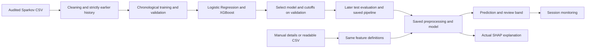

# FraudShield AI

**Intelligent Credit Card Fraud Detection & Transaction Analytics**

[Open the application](https://creditvault.streamlit.app/) · [Learning guide](LEARNING_GUIDE.md) · [Download the PDF guide](FraudShield_Learning_Guide.pdf)

FraudShield is a Streamlit ML project that accepts readable card-payment details, runs a trained classifier, and explains its output. Its single primary dataset is **Sparkov synthetic credit-card transactions**. It does not connect to a bank or claim that simulated data proves real-bank performance.

The default page is a working manual form. **No statement upload, PCA components, card number, or receiver balance is required.**

## Try the application

1. Open **Fraud prediction**. Enter an amount in **USD**, a purchase category, merchant, date, and time.
2. Choose how to supply spending context: enter earlier-activity summaries, use a demo card's recorded history, or select **No earlier history**.
3. Click **Analyze transaction**. The saved model returns a predicted class, model score, risk band, and genuine SHAP-based explanation.
4. Change a field and analyze again. Old results clear when inputs change; identical inputs under the same settings produce identical scores.
5. Open **Model performance** to examine actual mistakes, or **Transaction monitoring** to review analyses from this session.

The displayed number is an **uncalibrated model score**, not a verified probability of fraud. “Predicted legitimate” does not guarantee safety. Low/Medium/High are explained review bands based on the saved cutoff.

## Dataset: what was actually used?

Source: [Kartik Shenoy's Sparkov-derived credit-card dataset](https://www.kaggle.com/datasets/kartik2112/fraud-detection), generated using [Sparkov](https://github.com/namebrandon/Sparkov_Data_Generation).

The verified public **fraudTest.csv portion** contains **555,719 transactions**, **2,145 fraud labels**, and **924 synthetic accounts**, from June 21 to December 31, 2020. Amounts are in USD. This project creates its own chronological splits within that portion; it does not claim to use the publisher's full approximately 1.85-million-row collection or its original train/test partition.

The source has no exact duplicate records. Raw account numbers, names, addresses, demographics, occupations, and coordinates are excluded from the model and deployed exports. Customer aliases group history; identifiers themselves are not predictive inputs. Merchant names support familiarity checks and display, not direct merchant-name classification.

The full raw CSV stays outside the repository. Its SHA-256 is `12d553ab19440c752d2531ee1af44bb64f12cc3d3839f1649f19e81c230545f0`. Pinned source URLs, archive integrity checks, scope, and licensing verification limits are recorded in [the source manifest](../shield_artifacts/source_manifest.json).

**Why this dataset?** It supports readable card-purchase inputs and genuine historical features. ULB's private PCA components cannot be reconstructed from a normal payment form; PaySim models mobile-money transfers. The Handbook simulator and IBM TabFormer are credible synthetic alternatives, but switching to them offered no necessary benefit over the already audited Sparkov data. See the [dataset comparison and repository audit](FINAL_PROJECT_AUDIT.md).

## The six pages

| Page | What it does |
| --- | --- |
| **Fraud prediction** | Accepts user-entered payment details; validates context; performs real inference; shows a prediction, risk band, score, and actual model contributions. |
| **Overview** | Shows complete-source label counts, USD purchase statistics, daily fraud trends, and category charts. A separate section shows this session's prediction counts. |
| **Batch analysis** | Validates a readable CSV, derives each customer's strictly earlier history, scores all rows, highlights flags, and downloads every result. |
| **Model performance** | Compares Logistic Regression and XGBoost on the complete later test period, with precision, recall, F1, PR-AUC, ROC-AUC, confusion matrix, and missing-history evaluation. |
| **Explainable AI** | Shows genuine global SHAP importance and individual waterfalls with readable feature names; explains contributions without claiming causality. |
| **Transaction monitoring** | Lists analyses from this browser session, with merchant/customer/transaction search, risk filters, and downloads. This is not a live bank feed. |

Every page starts with **What am I looking at?** Metric cards include plain-English help. The responsive dark interface uses Plotly and native Streamlit controls, with reduced-motion support.

Screenshots from the validated local app: [manual form](screenshots/prediction-desktop.png), [overview](screenshots/overview-desktop.png), and [phone layout](screenshots/prediction-phone.png).

## Inputs and preprocessing

The saved model receives the same **13 features** in training and prediction:

| Input | Plain meaning |
| --- | --- |
| Payment amount | Current purchase value in USD. |
| Time of day — two numeric coordinates | The clock time represented on a circle, so 23:59 stays close to 00:01. |
| Day of week | Monday through Sunday, derived from the date. |
| Purchase category | Groceries, travel, shopping, and the other supported categories. |
| Earlier average payment | Mean amount of strictly earlier purchases on the card. |
| Amount compared with earlier average | Current amount divided by the earlier mean. |
| Payments in previous hour | Number of earlier purchases within the last 60 minutes. |
| Payments in previous 24 hours | Number within the last day; includes the previous-hour count. |
| Minutes since previous payment | Time gap since the most recent earlier purchase; not processing duration. |
| Merchant used before | Whether the customer previously paid this merchant. |
| Category used before | Whether the customer previously made this type of purchase. |
| Earlier activity available | Explicit indication of whether history exists. |

Numerical missing values use medians learned from training data. Purchase categories are one-hot encoded. Logistic Regression also standardizes numerical features; XGBoost uses their unscaled values. The exported pipeline contains these fitted transformations, so the dashboard does not independently recreate a scaler or encoder.

Manual summaries are supplied by the user. For demo history and batches, the shared history function derives them from actual earlier rows. Future records, answer labels, and transactions at the same timestamp never enter a transaction's historical features.

**No-history fallback:** 20% of training rows have their history deliberately masked, independently of the fraud label. This trains the same model to handle unavailable context. Its missing-history cutoff is selected separately on validation data, and its performance is reported separately by withholding history on later test records. This is not a study of unseen real customers.

## Training and honest evaluation

| Period | Transactions | Fraud | Dates |
| --- | ---: | ---: | --- |
| Training | 333,495 | 1,560 | June 21–October 26, 2020 |
| Validation | 114,518 | 409 | October 27–December 7, 2020 |
| Later test | 107,706 | 176 | December 8–31, 2020 |

All cleaned training rows are retained. There is no SMOTE or undersampling. Logistic Regression uses balanced class weights; XGBoost weights the positive class using the square root of the training negative/positive ratio. Validation and test preserve their original class distribution.

The bounded search fits two Logistic Regression regularization settings (`C=0.1, 1.0`) and two XGBoost depths (`3, 5`). XGBoost uses 350 trees, learning rate 0.06, row sampling 0.85, feature sampling 0.9, and two CPU workers. Seed 42 makes the experiment reproducible. No training happens during app startup.

For each candidate, the alert cutoff maximizes validation F1. Validation F1, then average precision, selects the final candidate. **XGBoost at depth 5 was selected.** The baseline and all genuine tuning results remain in the metadata. Only one selected fitted model serves the app; the comparison is not an ensemble of both algorithms.

### Complete later-period results with history

| Model | Precision | Recall | F1 | PR-AUC | ROC-AUC |
| --- | ---: | ---: | ---: | ---: | ---: |
| Logistic Regression | 10.44% | 53.41% | 17.47% | 7.21% | 93.99% |
| **XGBoost — selected** | **68.39%** | **67.61%** | **68.00%** | **71.95%** | **99.58%** |

At cutoff **0.8739676476**, XGBoost caught **119** fraud cases, missed **57**, and incorrectly flagged **55** legitimate transactions. Its confusion matrix, with actual classes as rows and predicted classes as columns, is:

```text
                         Predicted legitimate   Predicted fraud
Recorded legitimate             107,475                   55
Recorded fraud                       57                  119
```

Accuracy is **99.896%**, but calling every test transaction legitimate already achieves **99.837%** while detecting no fraud. Precision, recall, and those error counts matter more.

### Missing-history evaluation

When earlier context is withheld, the selected model's validation-chosen cutoff is **0.8773067594**. It catches **114** fraud cases, misses **62**, and raises **82** false alarms: **58.16% precision**, **64.77% recall**, and **61.29% F1**. The app does not reuse the with-history metrics to describe this fallback.

**Evaluation limit:** previous project experiments already inspected this public dataset and aggregate results from its later period. The current tuning and cutoff selection use validation only, but this is a **development holdout**, not a pristine external-bank audit. Synthetic patterns and the small number of test fraud cases limit generalization claims.

## Explainability

SHAP uses 64 actual earlier training rows as its reference. Local contributions are grouped back from encoded columns to readable inputs, including the purchase category and time of day. Reference plus all contributions reconstructs the selected model's log-odds; applying the logistic function recovers its actual score. The code checks that identity.

The global chart uses a fixed uniform sample of 128 later test records. It is labeled as a sample explanation; evaluation uses all 107,706 test records. Model contributions describe the calculation, not proven reasons someone committed fraud.

## Architecture



## Run locally

Python **3.12** is recommended. Install the recorded scientific versions because the supplied model is serialized with them.

```bash
git clone https://github.com/me-vishnurnair/Machine-learning-project.git
cd Machine-learning-project
python -m venv .venv
source .venv/bin/activate
python -m pip install -r requirements.txt
streamlit run app.py
```

On Windows PowerShell, activate with `.venv\Scripts\Activate.ps1`. The model, source aggregates, and demo histories are already included. You do not need a Kaggle login, API key, raw dataset, or model retraining to run the app.

## Batch CSV format

Download the template from the app. Required columns:

```csv
transaction_id,customer_id,timestamp,amount,currency,merchant,category
example-1,customer-a,2020-12-15 13:00:00,40.00,USD,Example shop,shopping_net
example-2,customer-a,2020-12-15 14:00:00,125.00,USD,Another shop,shopping_net
```

Use supported category codes from the app, unique transaction IDs, positive finite amounts, and consistent local timestamps without timezone offsets. Maximum: **10 MB and 10,000 rows**. Every customer starts with no history in a new uploaded file; later rows can use earlier rows in that file. Fraud labels and extra columns are ignored. The template contains actual synthetic source rows selected for demonstration, not a representative evaluation sample. Its shorter history can produce different scores from the complete-history experiment. The preview shows up to 500 rows; the download contains every result. This is not a universal PDF or bank-statement importer.

## Reproduce training and evaluation

The data download is approximately 64 MB compressed / 150 MB extracted. It stays outside the checkout. The helper verifies the published archive and CSV checksums using normal TLS.

```bash
python scripts/download_training_data.py --output /tmp/fraudshield-data
python train_shield.py \
  --data /tmp/fraudshield-data/sparkov_verified.csv \
  --source-manifest shield_artifacts/source_manifest.json \
  --output shield_artifacts
python scripts/evaluate_shield.py
```

Training writes the fitted pipeline, provenance, exact feature order, version pins, validation/test reports, full test features and scores, portable histories, examples, and true SHAP summaries. If changing features, retrain and export the whole bundle together. Do not mix old weights with new preprocessing.

```bash
python -m pip install -r requirements-dev.txt
python -m pytest -q
```

The tests cover genuine inference parity, all later test predictions, SHAP reconstruction, history leakage, feature order, missing history, bad uploads, manual edits, stale results, navigation, and monitoring. Browser checks additionally exercise actual CSV upload/download and phone layouts. Software-test counts are separate from the number of transactions used for model evaluation.

Final local validation: **319 automated tests passed**, plus **45 desktop/phone browser checks** and two additional phone-header/layout assertions. One pandas parsing warning is expected from a deliberately invalid-date test. The complete saved test set was replayed for both history contexts, all recorded examples reconstructed their true SHAP scores, and a fresh source download passed archive/CSV integrity verification. `scripts/verify_deployment.py --expected-commit <pushed-SHA>` checks the public app's six pages, displayed metrics, actual positive/negative predictions, SHAP, and missing-history behavior through Streamlit's protocol using verified TLS.

The PDF is already included. Rebuilding it is optional and requires `reportlab` plus the DejaVu fonts used by `scripts/build_learning_guide.py`; those are documentation tools, not application startup requirements.

## Streamlit Community Cloud

The existing app uses repository `me-vishnurnair/Machine-learning-project`, branch **main**, and entry point **app.py**. Keep that connection; pushing main triggers the connected deployment. For a new deployment, select those values in Streamlit Community Cloud and Python 3.12 in advanced settings.

No secrets or paid services are required. Models use `st.cache_resource`; public dataset assets and explanations use `st.cache_data`. Native lazy tabs render only the selected page. The selected pipeline is approximately 236 KB and the new bundle approximately 8 MB; normal startup does not load the full evaluation matrices or raw source data. Free hosting can sleep or restart and does not promise continuous availability.

## Files

```text
app.py                         Public Streamlit entry point
shield_dashboard.py            Six pages, real input flow, session monitoring
shield_core.py                 Inference, CSV validation, genuine SHAP
card_core.py                   Reused strictly-earlier-history feature logic
manual_card_core.py             Validated manual-summary adapter
train_shield.py                 Reproducible LR/XGBoost experiment
shield_artifacts/              Current model, data summaries, measured results
assets/fraudshield.css          Responsive dark visual style
scripts/                       Download and full-evaluation helpers
requirements.txt               Runtime and exported-model version pins
.streamlit/config.toml         Deployment theme and server settings
tests/                         Current and preserved historical checks
docs/                          Learning guide, dataset audit, archived reports
```

The ULB, PaySim, and previous Sparkov implementations remain as historical work. They do not supply the current app's scores or metrics. Their older READMEs and guides must not be used to describe FraudShield's selected model.

## Limitations and next steps

- Synthetic training and evaluation do not prove real-world bank performance.
- Scores are uncalibrated; predictions and review bands are not guarantees.
- User-entered summaries are only as reliable as the supplied facts.
- USD is the supported currency. Adding a currency symbol is not conversion or validation in another market.
- A file with little history has less context; the fallback's measured limitations are explicit.
- Monitoring is session-only, capped at 5,000 unique IDs. It is not a bank integration or durable audit database.
- Future improvements include an authorized real-card dataset with readable fields, an untouched external evaluation, probability calibration, and more robust validation on unseen customers.

For a presentation script, feature meanings, a walkthrough, and ten viva answers, read the [beginner learning guide](LEARNING_GUIDE.md).
